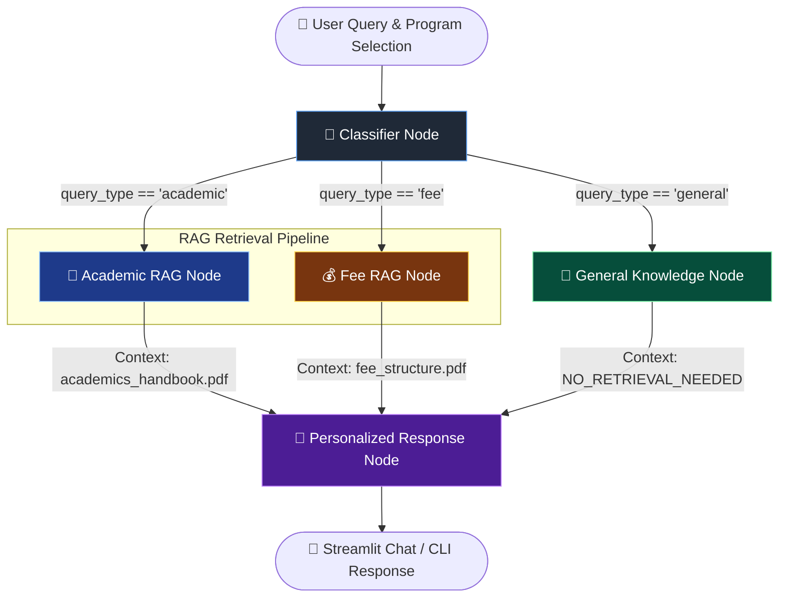

# 🎓 College AI Assistant – Agentic RAG with LangGraph & Streamlit

[](https://www.python.org/)
[](https://www.langchain.com/langgraph)
[](https://www.langchain.com/)
[](https://groq.com/)
[](https://streamlit.io/)
[](https://github.com/facebookresearch/faiss)

An intelligent, context-aware **College AI Assistant** built using **LangGraph**, **LangChain**, **Groq (Llama 3.3 70B)**, and **FAISS Vector Search**. 

The assistant uses an **agentic conditional workflow graph** that dynamically classifies student queries into specific domain categories (`academic`, `fee`, or `general`) and routes them to specialized Retrieval-Augmented Generation (RAG) retrieval nodes or a general knowledge model. Furthermore, responses are dynamically personalized according to the student's degree program (e.g., **BCA**, **BBA**, or **B.Com (H)**).

---

## 🌟 Key Features

- 🧠 **Dynamic Intent Classification**: Intelligent zero-shot classification node that routes incoming user prompts to domain-specific pipelines.
- ⚡ **Conditional LangGraph Workflow**: State graph orchestration featuring dynamic routing edges for minimal latency and precise context retrieval.
- 📚 **Dual-Document RAG Pipelines**:
  - **Academic RAG Node**: Retrieves official guidelines, attendance policies, credits, and grading criteria from `academics_handbook.pdf`.
  - **Fee RAG Node**: Retrieves tuition schedules, payment deadlines, refund policies, and scholarship rules from `fee_structure.pdf`.
  - **General Knowledge Node**: Handles greetings and general queries directly using Llama 3.3 70B without redundant vector lookup overhead.
- 🎯 **Program-Aware Personalization**: Tailors answers based on student degree program selection (BCA, BBA, B.Com (H)).
- 🎨 **Modern Streamlit UI**: Sleek conversational web app with custom CSS styling, visual query intent badges (`ACADEMIC`, `FEE`, `GENERAL`), clear chat controls, and programme selectors.
- 💻 **CLI Debugger Support**: Includes a lightweight command-line script (`3) Conditional_workflow_And_RAG.py`) for rapid local testing and terminal interaction.

---

## 🏗️ Architecture & Workflow

The application leverages **LangGraph `StateGraph`** to manage state transitions across multiple specialized nodes:



### Detailed Graph Flow
1. **User Message**: Prompt is received along with student programme context.
2. **Classifier Node**: Analyzes query intent via Llama 3.3 70B and labels it as `academic`, `fee`, or `general`.
3. **Conditional Router**: Evaluates `state["query_type"]` and directs control flow:
   - Queries about credits, exams, attendance $\rightarrow$ `academic_rag_node` (FAISS search on `academics_handbook.pdf`).
   - Queries about tuition, payments, refunds $\rightarrow$ `fee_rag_node` (FAISS search on `fee_structure.pdf`).
   - Casual conversation / general topics $\rightarrow$ `general_node` (Bypasses vector search).
4. **Response Generation Node**: Synthesizes retrieved context and formats a clear, personalized response for the student's specific program.

---

## 🛠️ Tech Stack

| Component | Technology | Purpose |
| :--- | :--- | :--- |
| **Workflow Graph** | [LangGraph](https://github.com/langchain-ai/langgraph) | Agentic state graph, conditional edges, & node orchestration |
| **LLM Provider** | [Groq API](https://groq.com/) | High-speed inference using `llama-3.3-70b-versatile` |
| **Embeddings** | [HuggingFace Embeddings](https://huggingface.co/) | `sentence-transformers/all-MiniLM-L6-v2` dense vector representations |
| **Vector Store** | [FAISS](https://github.com/facebookresearch/faiss) | Fast in-memory similarity search for document chunks |
| **Document Loaders** | PyPDFLoader & RecursiveCharacterTextSplitter | Extracting and chunking PDF handbooks |
| **Web Interface** | [Streamlit](https://streamlit.io/) | Interactive chat UI with custom CSS & session state management |
| **Environment** | Python 3.10+, `python-dotenv` | Configuration & secret management |

---

## 📁 Repository Structure

```gcode
Collage AI chat/
├── app.py                             # Main Streamlit web application
├── 3) Conditional_workflow_And_RAG.py # Interactive CLI application script
├── academics_handbook.pdf             # Academic rules & regulations document
├── fee_structure.pdf                  # College fee schedule & refund policy document
├── requirements.txt                   # Python project dependencies
├── .env.example                       # Example environment variable file
├── .gitignore                         # Git ignore rules for virtualenv, keys & cache
└── README.md                          # Project documentation
```

---

## 🚀 Getting Started

### 1. Prerequisites
- **Python**: Version `3.10` or higher installed.
- **Groq API Key**: Obtain a free key from the [Groq Console](https://console.groq.com/).

### 2. Clone the Repository
```bash
git clone https://github.com/your-username/college-ai-chat.git
cd college-ai-chat
```

### 3. Create & Activate Virtual Environment
- **On Linux/macOS:**
  ```bash
  python3 -m venv .venv
  source .venv/bin/activate
  ```
- **On Windows (PowerShell):**
  ```powershell
  python -m venv .venv
  \.venv\Scripts\Activate.ps1
  ```

### 4. Install Dependencies
```bash
pip install --upgrade pip
pip install -r requirements.txt
```

### 5. Configure Environment Variables
Create a `.env` file in the root directory and add your API keys:
```env
GROQ_API_KEY=gsk_your_groq_api_key_here
```

*(Optional: Add `TAVILY_API_KEY` or `MISTRAL_API_KEY` if extending with web search capabilities)*

---

## 💻 Running the Application

### Option A: Launch Streamlit Web UI (Recommended)
Run the following command to start the interactive web server:
```bash
streamlit run app.py
```
The browser will automatically open at `http://localhost:8501`.

#### Streamlit UI Highlights:
- **Sidebar**: Select your academic programme (**BCA**, **BBA**, **B.Com (H)**) and clear chat history.
- **Visual Badges**: Assistant messages display real-time query classification badges (`ACADEMIC`, `FEE`, `GENERAL`).

---

### Option B: Run in Terminal (CLI Mode)
To run the lightweight command-line version:
```bash
python "3) Conditional_workflow_And_RAG.py"
```
Follow the on-screen prompts to select your programme and start asking questions!

---

## 📄 Customizing Knowledge Base PDFs

You can easily adapt this assistant to any college or institution by updating the source PDF files in the repository root:
1. Replace `academics_handbook.pdf` with your college academic handbook.
2. Replace `fee_structure.pdf` with your institution's fee schedule.
3. Restart the Streamlit server; FAISS vector stores will automatically rebuild on startup.

---

## 🤝 Contributing

Contributions are welcome! If you'd like to improve the RAG performance, add multi-file memory, or enhance the UI:
1. Fork the Project
2. Create your Feature Branch (`git checkout -b feature/AmazingFeature`)
3. Commit your Changes (`git commit -m 'Add some AmazingFeature'`)
4. Push to the Branch (`git push origin feature/AmazingFeature`)
5. Open a Pull Request

---

## 📜 License

Distributed under the MIT License. See `LICENSE` for more information.
